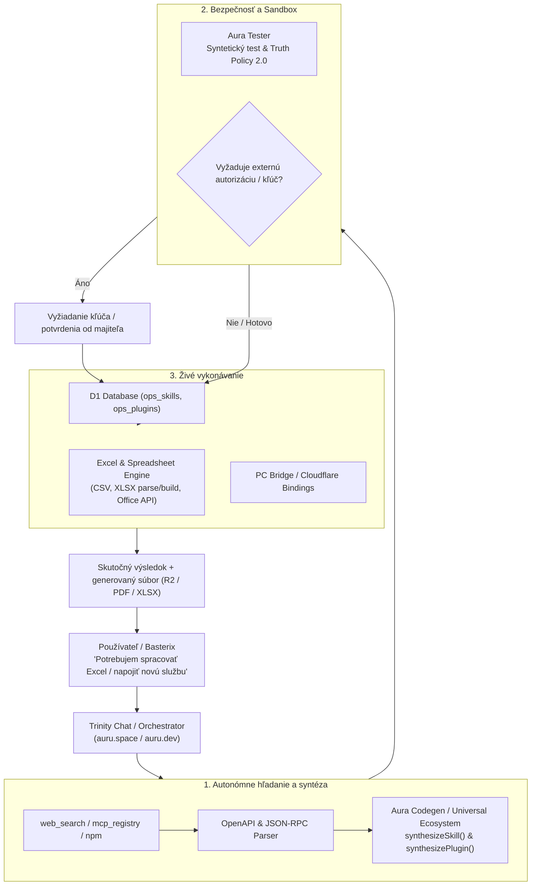

# Trinity: Architektonický plán pre autonómne rozširovanie nástrojov, pluginov a externé integrácie (Excel & Web)

**Dátum vytvorenia:** 25. 10. 2026  
**Autor:** Sabo Ivan (Basterix) & Trinity Triad (Antigravity + Codex)  
**Stav:** Schválený plán do roadmapy (Ready for implementation)

---

## 1. Vízia a princíp fungovania

Trinity sa posúva z modelu statického zoznamu nástrojov do modelu **aktívneho autonómneho objavovania a samorozširovania (Dynamic Tool Synthesis & Autonomous Integration)**:
1. **Nestačí len textová definícia:** Každý nový skill a plugin musí byť skutočne spustiteľný (`executable: true`), mať jasnú schému vstupov/výstupov a overiteľný doklad o vykonaní (Truth Policy 2.0).
2. **Autonómne vyhľadanie a inštalácia:** Keď používateľ zadá požiadavku, na ktorú chýba lokálny nástroj, Trinity sama:
   - Vyhľadá relevantnú špecifikáciu (OpenAPI, MCP manifest, npm balík, REST dokumentáciu alebo webový zdroj).
   - Syntetizuje bezpečný javascriptový handler pre Worker runtime alebo PC Bridge.
   - Otestuje funkčnosť v izolovanom sandboxe.
   - Zaregistruje skill/plugin do D1 (`ops_skills`, `ops_plugins`) a aktivuje ho v runtime bez nutnosti manuálneho re-deployu celého repozitára.
3. **Praktické pracovné prepojenie (napr. Excel / Tabuľky / Kancelária):**
   - Pripojenie súborov Excel (.xlsx), CSV a Microsoft Graph / Office 365 API.
   - Schopnosť priamo čítať, parsovať tabuľkové hárky, generovať vzorce, vykonávať kalkulácie a exportovať hotové tabuľky ako R2/D1 artefakty s jedným kliknutím.

---

## 2. Architektonické piliere

---

## 3. Komponenty na realizáciu

### A. Autonómny Plugin & Skill Inštalátor (`skill_autonomous_installer`)
- **Vstupy:** URL adresa dokumentácie, OpenAPI špecifikácia, GitHub repozitár alebo názov služby.
- **Funkcie:**
  - `inspect_external_api(url)`: Stiahne a analyzuje koncový bod, metódy, autentifikačné hlavičky a dátové typy.
  - `generate_skill_binding(spec)`: Vygeneruje čistý JavaScript handler kompatibilný s Cloudflare Workers a `runTool(env, agent, tool, args)`.
  - `verify_sandbox(skill_id)`: Otestuje mock/read volanie so zamedzením SSRF (iba whitelistované alebo schválené domény).
  - `activate_skill(skill_id)`: Uloží do tabuľky D1 `ops_skills` a okamžite sprístupní pre všetkých 45 agentov.

### B. Excel & Spreadsheet Engine (`skill_excel_bridge` / `office_connector`)
- **Spracovanie formátov:**
  - Plná podpora formátov `.xlsx`, `.xls`, `.csv`, `.tsv`.
  - Lokálne parsovanie a generovanie cez odľahčenú knižnicu (napr. čistý ES modul pre XLSX/SheetJS bez Node.js závislostí) priamo vo Workeri.
- **Kľúčové akcie:**
  - `excel_read_sheet(artifact_id, sheet_name)`: Vráti štruktúrované riadky a stĺpce s typmi buniek.
  - `excel_write_sheet(filename, data, formatting)`: Vytvorí XLSX tabuľku, uloží ju do R2 bucketu `trinity-artifacts` a vráti overený odkaz na stiahnutie.
  - `excel_formula_calc(sheet_data, formula)`: Skontroluje a prepočíta vzorce (SUM, AVERAGE, VLOOKUP, XLOOKUP, IF) pred exportom.
  - `excel_connect_live(sharepoint_or_onedrive_url)`: Prepojenie na živý cloudový zošit cez Microsoft Graph API s OAuth tokenom uloženým v Secret Vault.

### C. Zabezpečenie a Truth Policy pre dynamické nástroje
- Žiadny dynamicky nainštalovaný nástroj nesmie obchádzať Truth Policy:
  - Ak nástroj volá externú službu a tá vráti chybu alebo timeout, nástroj musí vrátiť `status: failed`.
  - Nástroj nikdy nesmie predstierať odpoveď tretej strany.
  - Ak služba vyžaduje privátny kľúč, Trinity požiada majiteľa o jeho zadanie cez zabezpečený Vault dialóg namiesto hádania.

---

## 4. Fázy implementácie

| Fáza | Názov | Popis | Výstup |
| :--- | :--- | :--- | :--- |
| **Fáza 1** | **Excel & Table Artifacts** | Vytvorenie nástroja pre tvorbu a čítanie XLSX/CSV súborov z chatu. | `excel_create`, `excel_analyze`, ukladanie do R2 s priamym stiahnutím v UI. |
| **Fáza 2** | **OpenAPI / Web Skill Importer** | Možnosť zadať odkaz na web/API, Trinity vygeneruje a otestuje skill. | `plugin_import_from_web`, zápis do D1 `ops_plugins`. |
| **Fáza 3** | **Office 365 / Microsoft Graph** | Pripojenie na živé cloudové konto Microsoft / Google Drive pre synchrónnu prácu. | OAuth integrácia, synchronizácia hárkov v reálnom čase. |

---

Tento dokument slúži ako záväzná špecifikácia pre nasledujúce vývojové iterácie Trinity Triad.
