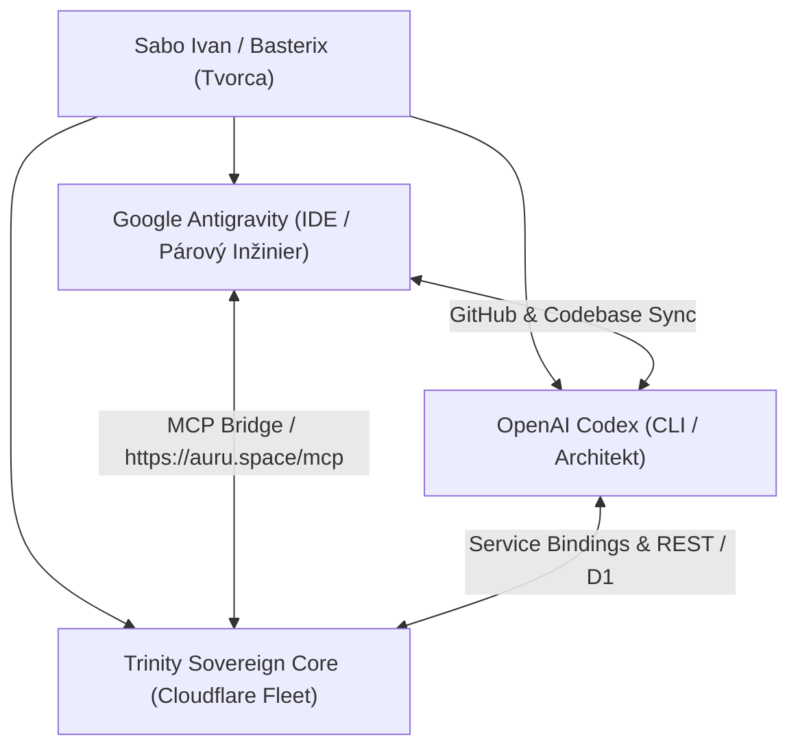

# Trinity Sovereign AI Ecosystem 2026 – Systémová Špecifikácia & Dokumentácia

> **Verzia:** 11.0.0-sovereign  
> **Kánonický repozitár:** [uscolective-byte/Trinity-antigravity](https://github.com/uscolective-byte/Trinity-antigravity) (vetva `main`)  
> **Zrkadlený repozitár:** [uscolective-byte/trinity-morhfeus](https://github.com/uscolective-byte/trinity-morhfeus) (vetva `main`)  
> **Produkcia:** [https://auru.space](https://auru.space) (Worker `trinity`)  
> **Staging:** [https://auru.dev](https://auru.dev) (Worker `trinity-staging`)  
> **Majiteľ a Tvorca:** Sabo Ivan / Basterix (`saboivan2008@gmail.com`)  
> **Dátum aktualizácie:** 27. október 2026

---

## 1. Architektonický Prehľad (Triáda)

Ecosystem Trinity je postavený na suverénnej triáde troch spolupracujúcich agentov:



1. **Antigravity (Google DeepMind)**: Primárny vývojový a refaktoringový inžinier v lokálnom IDE prostredí s priamym prístupom k súborom, testom a terminálu.
2. **OpenAI Codex**: Architektonický a analytický partner pre CLI operácie, hĺbkový audit a generovanie modelov.
3. **Trinity Sovereign Core**: Autonómna multi-agentná cloudová flotila bežiaca na Cloudflare Workers Edge (`auru.space`), spravujúca 29 viazaných služieb, databázy, pamäť a verejné rozhranie.

---

## 2. Cloudflare Edge Infraštruktúra & Úložiská

| Komponent | Názov / ID | Účel |
|:---|:---|:---|
| **Jednotný Worker** | `trinity` | Obsluhuje produkciu `auru.space`, API, chat, MCP a úlohy. |
| **Staging Worker** | `trinity-staging` | Obsluhuje predprodukciu `auru.dev` chránenú Zero Trust tokenom. |
| **D1 Databáza (Primárna)** | `trinity-v03` (`ca8ea24e-f7db-431e-b8bf-97f713ae4533`) | Pamäť relácií, audit logy, stav úloh, profily a účty. |
| **D1 Databáza (Sekundárna)** | `trinity-db` | Domény, analytika a sekundárne záznamy. |
| **D1 Databáza (Bridge)** | `trinity-pc-bridge` | Auditné stavy a záznamy operácií lokálneho počítača. |
| **KV Namespace** | `Mastermind` (`0b92ed2717d742daa860f1827797297f`) | Rýchla cache konfigurácie, feature flagy, autorizácie. |
| **R2 Bucket** | `trinity-artifacts` | Trvalé ukladanie vygenerovaných kódov, obrázkov, videí a reportov. |
| **Cloudflare Workflow** | `trinity-operations` | Dlhotrvajúce operácie, plánovanie na pozadí, autonómna údržba. |
| **Secrets Store** | `default_secrets_store` (`5ba06ba934c343fa8c0dc5454ce67038`) | Šifrované ukladanie tajomstiev na úrovni Cloudflare účtu. |

---

## 3. Flotila 29 Viazaných Cloudflare Workers

Trinity riadi 29 špecializovaných služieb cez `env` väzby (Service Bindings):

### A. 10× AURA Špecialisti (Autonómne Vývojové Jadro)
- `AURA_ANALYZER`: Statická analýza kódu, detekcia zraniteľností a bezpečnosť.
- `AURA_ARCHITECT` (`admino`): Návrh systémovej architektúry, schém a modulov.
- `AURA_CODEGEN`: Generovanie čistého a typovo bezpečného kódu.
- `AURA_DEPLOYER` (`Trinity`): Riadenie nasadzovania a overovanie verzií.
- `AURA_EVOLVER`: Autonómne vylepšovanie nástrojov a rozširovanie schopností.
- `AURA_MEMORY`: Sémantické indexovanie a dlhodobá vektorová pamäť.
- `AURA_OPTIMIZER`: Výkonnostná optimalizácia databáz a odozvy.
- `AURA_PLANNER`: Tvorba viacfázových plánov s vyhodnocovaním rizika.
- `AURA_SENTINEL` (`admin`): Stráženie bezpečnosti, oprávnení a integrity.
- `AURA_TESTER`: Automatické spúšťanie a vyhodnocovanie validačných testov.

### B. 8× Trinity Core Špecialisti
- `CORE` (`trinity-core`): Základný beh a koordinácia dopytov.
- `BUILDER` (`trinity-builder`): Syntéza pluginov, generovanie webov (AI Studio).
- `DISPATCHER` (`trinity-dispatcher`): Smerovanie požiadaviek medzi agentov.
- `CONNECTORS` (`trinity-connectors`): Integrácie tretích strán (GitHub, OpenAI, Gemini).
- `GUARDIAN` (`trinity-guardian`): Validácia vstupov a ochrana pred prompt injection.
- `MEMORY` (`trinity-memory`): D1 a KV perzistentné úložisko relácií.
- `SENTINEL` (`trinity-sentinel`): Dozor nad Truth Policy a auditom.
- `SKILLS` (`trinity-skills`): Katalóg a dynamické vykonávanie schopností.

### C. 8× Špecializované & RPC Služby
- `KNOWLEDGE_SERVICE` (`trinity-knowledge`): Vektorové a encyklopedické znalosti.
- `CAPACITY_SERVICE` (`trinity-capacity`): Monitorovanie limitov a kvót.
- `INTEGRATIONS_SERVICE` (`trinity-integrations`): Správa externých API adaptérov.
- `PC_BRIDGE_SERVICE` & `PC_BRIDGE_V2`: Zabezpečený most pre prácu s lokálnym PC.
- `AUDIT_SERVICE` (`trinity-audit`): Nemenné auditné záznamy s podpisom.
- `JERICHO_SERVICE` (`jericho123`): Krypto super-agent, Binance live feed a správa Tetrakis ($TTK).
- `CHAT_INFERENCE_SERVICE` (`trinity-chat-inference`): Rýchla inferencia pre chat.

### D. 3× Durable Objects
- `Brain` (`TrinityAgent`): Perzistentný stav hlavného agenta.
- `CHAT_AGENT` (`ChatAgent`): WebSocket a real-time relácie pre chat.
- `GUARDIAN_AGENT` (`GuardianAgent`): Ochranný strážca stavu a limitov.

---

## 4. Režim Pravdy (Truth Policy 2.0) & Žiadne Simulácie

Trinity striktne podlieha **Truth Policy 2.0**:
1. **Zákaz vymýšľania a simulácie**: Trinity nesmie vygenerovať odpoveď, ktorá predstiera vykonanie príkazu v termináli alebo inštaláciu softvéru, pokiaľ na to nemá reálny dôkaz.
2. **Povinné systémové potvrdenie (Receipt)**: Každá externá akcia (zápis do DB, mutácia, volanie GitHubu, čítanie súboru, výpočet) musí obsahovať kryptografické alebo unikátne UUID potvrdenie:
   ```json
   {
     "tool": "github_manage",
     "status": "completed",
     "effect": "read",
     "receipt_id": "github:status:e35c349d-333f-44e9-8b50-6d64dfc245a9",
     "verified_at": "2026-10-27T17:17:41.432Z"
   }
   ```
3. **Automatické prepísanie nepravdivých tvrdení**: Ak LLM model vygeneruje nepodložené tvrdenie o nainštalovaní softvéru či spustení príkazu, engine ho automaticky nahradí pravdivým vyhlásením o absencii systémového dôkazu.

---

## 5. Schopnosti a Skutočné Nástroje

Trinity disponuje **152 certifikovanými schopnosťami** a **248 Copilot pluginmi**:

- **Prehliadanie webu cez Puppeteer (`browser_scrape`, `browser_render`)**: Skutočný headless prehliadač v Cloudflare na extrakciu dát z moderných SPA aplikácií a renderovanie screenshotov.
- **Deterministický GitHub Engine (`github_manage`)**:
  - `status`: Zistenie skutočného stavu repozitára.
  - `get_file` / `read_file`: Čítanie ľubovoľného súboru priamo z GitHubu.
  - `list_files` / `list_tree`: Prehliadanie adresárovej štruktúry kánonického repozitára.
- **Domain Engine**: Vyhľadávanie, nákup, správa DNS a prenájom domén cez Cloudflare Registrar API.
- **AI Studio & Web Builder**: Generovanie a náhľad moderných webov a aplikácií.
- **Matematika a Analýza dát**: Presné výpočty (`calculate`), štatistika, prevody jednotiek, diffy a JSON transformácie.
- **Krypto Analýza & Pokladnica (Jericho)**: Sledovanie trhu, feed z Binance a správa ERC-20 tokenu $TTK.
- **PC Bridge (Lokálny most)**: Bezpečné čítanie systémových informácií z lokálneho PC s podpisom a overením.

---

## 6. Viacúrovňové AI Modely & Tokenový Rozpočet

- **Primárny fast-tier**: `@cf/meta/llama-3.3-70b-instruct-fp8-fast` (Cloudflare Workers AI).
- **Záložný model**: `@cf/meta/llama-3.1-8b-instruct-fp8-fast`.
- **Pokročilé externé modely**: `gemini-3.8-flash` (Google) a `gpt-4.1-mini` (OpenAI).
- **Multimodálne modely**:
  - Obrázky: `@cf/black-forest-labs/flux-1-schnell`.
  - Videnie (Vision): `@cf/meta/llama-3.2-11b-vision-instruct`.
  - Reč (STT/TTS): `@cf/openai/whisper-large-v3-turbo` / `@cf/myshell-ai/melotts`.
- **Tokenový rozpočet pre uvažovanie**: `4096 max_tokens`, kontextové okno `64 000 tokenov`, až 15 autonómnych krokov v jednom behu.

---

## 7. Overovacie Príkazy a Postup Nasadenia

### Overenie a testy:
```powershell
# V koreňovom priečinku
npm.cmd run check

# V priečinku Trinity
cd Trinity
npm test
```

### Nasadenie do produkcie:
```powershell
cd Trinity
npm run deploy -- --tag <git-sha>
```

### Overenie živého nasadenia:
```powershell
node Trinity/scripts/verify-deployment.mjs https://auru.space <git-sha>
```

---

## 8. Plná Autonómia a Schvaľovací Model pre Vlastníka (Sabo Ivan / Basterix)

Od verzie 11.0.0 (commit `95ac8aa`) má majiteľ systému (**Sabo Ivan / Basterix**, `saboivan2008@gmail.com`) natívne odomknuté plné autonómne vykonávanie:

1. **Automatický Owner Mode (`owner_mode: true`)**:
   - Každá požiadavka zadaná cez webový chat (`/api/assistant/chat`), úlohy (`/api/ops/jobs`) alebo MCP Bridge (`dispatch_task`) od overeného administrátora/majiteľa sa spracováva priamo s `owner_mode: true`.
2. **Žiadne blokujúce schvaľovanie (`requires_approval: false`)**:
   - Plánovač (`planTask`) automaticky prideľuje plné práva (`grants_permissions: true`) a vypína požiadavku na druhé manuálne potvrdenie frázou `SCHVÁĽ`.
3. **Plný prístup k nástrojom bez obmedzení**:
   - `DEVELOPMENT_TOOLS` (GitHub, súbory, buildy), `OWNER_BUSINESS_TOOLS` (domény, obchod), `PC_TOOLS` (lokálne ovládanie cez PC Bridge), `execute_skill` a `ecosystem_synthesize` sú trvalo povolené bez vyhadzovania chyby autorizácie.

---

## 9. Katalóg 19 Suverénnych Skillov & Univerzálny Ekosystém

Všetkých 19 základných suverénnych skillov je priamo integrovaných a dostupných v jadre (`Trinity/src/skillRegistry.js`):

| Skupina | Skill ID | Schopnosť a Popis |
|:---|:---|:---|
| **Orchestrácia & Autonómia** | `trinity-core-orchestrator` | Koordinácia multi-agent úloh, delegovanie a pipeline. |
| | `trinity-tool-manager` | Vyhľadávanie, inštalácia a konfigurácia nástrojov a CLI. |
| | `self-modifying-code` | Riadené samo-upravovanie a rozširovanie kódu. |
| | `get-more-perspectives` | Poradný zbor 5 expertov (Operator, Skeptic, Visionary, Customer, Finance). |
| **Infraštruktúra & Edge** | `cloudflare-worker-manager` | Správa, konfigurácia a deployment Cloudflare fleetu a D1 databáz. |
| | `trinity-domain-manager` | DNS správa, registrácia a leasing domén. |
| | `api-integration-hub` | Prepojenie externých API (Google GenAI, OpenAI, Ollama, GitHub). |
| | `copilot-studio-connector` | Integrácia s MS Copilot Studio a Power Platform. |
| **Vývoj, Bezpečnosť & Git** | `polyglot-coder` | Vývoj a ladenie v Python, TypeScript, Node.js a Next.js. |
| | `codebase-inventory` | Hĺbková inventarizácia kódu a mapovanie závislostí. |
| | `autonomous-tester` | Tvorba, spúšťanie a validácia testovacích sád pred nasadením. |
| | `constitutional-security-audit` | Vynucovanie pravidiel sandboxu, ochrany dát a bezpečnosti. |
| | `system-security-guardian` | Monitorovanie runtime integrity a bezpečnostný dozor. |
| | `github-version-control` | Správa vetiev, PR, commitov a changelogov. |
| | `git-deployment-sync` | Synchronizácia repozitárov medzi `origin` a `morpheus`. |
| **Znalosti, Štýl & Docs** | `notion-workspace-sync` | Synchronizácia backlogu a Master Buildu s Notion. |
| | `doc-generator` | Automatické generovanie manuálov, systémových špecifikácií a kníh. |
| | `match-my-writing-style` | Adaptácia výstupov na osobný komunikačný štýl Sabo Ivana. |
| | `esoteric-knowledge-mapper` | Prepájanie dát, symboliky a systémových metafor. |

---

## 10. Multi-Platformová Synchronizácia (Cloudflare Fleet, PC Bridge, Mobile PWA)

- **Cloudflare Edge Fleet**: Unified Worker `trinity` obsluhujúci `https://auru.space` (a staging `https://auru.dev`) so zdieľaným D1 úložiskom `trinity-v03`, KV `Mastermind`, R2 `trinity-artifacts` a Workflow `trinity-operations`.
- **PC Bridge & Local Gateway**: Bounded PC Bridge (`Local-Gateway` a `Trinity/trinity-pc-bridge`) s kryptografickou verifikáciou, HMAC tokenmi a prísnym allowlistom príkazov pre lokálny počítač.
- **Mobilný Priestor (PWA)**: Responzívne rozhranie optimalizované pre telefóny, podpora mikrofónu, kamery, offline manifestu a okamžitej inštalácie bez emulácie.

